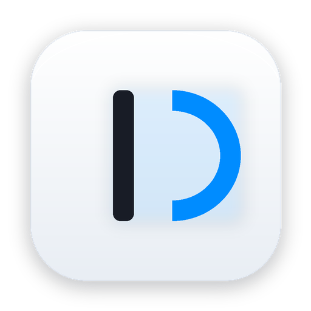

# Deck 🚀

> **A native, blazingly fast macOS efficiency platform for geeks & developers.**  
> Unifying **Multitouch Trackpad Gestures**, **Multi-Environment Hosts Switcher**, an **Instant HUD App Switcher**, and **Global Timezone Quick Switcher**.

<p align="center">
  
</p>

<p align="center">
  <a href="https://github.com/ztiandan/Deck/releases"></a>
  
  
  
  
</p>

---

## 🌟 Core Pillars

### 1. 🖐 Advanced Trackpad Gesture Engine
Directly bridges to macOS hardware touch frame streams with sub-millisecond latency, state-machine detection, and debounce cooldown:
- **TipTap Right (2F)** ➔ `⌘ W`: Hold 1 finger left, tap 1 finger right — close tab/window instantly.
- **TipTap Left (2F)** ➔ `⌘ R`: Hold 1 finger right, tap 1 finger left — reload current page.
- **TipTap Left (3F)** ➔ `^ ←`: Hold 2 fingers, tap leftmost finger — switch to previous space/tab.
- **TipTap Right (3F)** ➔ `^ →`: Hold 2 fingers, tap rightmost finger — switch to next space/tab.
- **4-Finger Tap** ➔ `⌘ + Click`: Tap with 4 fingers simultaneously — open link in background.
- **Menubar Quick Toggle**: Pause or resume gestures instantly from the menu bar.

### 2. 🌐 Multi-Environment Hosts Switcher
- **Instant Status Bar Switching**: Switch between profiles with a single click.
- **Folders & Mutual Exclusion**: Organize environments into logical groups.
- **Passwordless Writing**: Authorize once to write `/etc/hosts` without repeated password prompts.
- **Native Editor & Preview**: Monospaced editor with drafts and hover preview in the menu bar.

### 3. ⚡️ Instant HUD App Switcher & Palette
- **Global Single-Key Summoning**: Trigger a translucent HUD palette anywhere on screen (e.g. `F18`).
- **Direct Keystroke Switching**: Single key presses instantly switch to target applications.
- **Mechanical Keycap Aesthetic**: Refined appearance with duplicate validation and app search.

### 4. 🌍 Global Timezone Quick Switcher
- **Major Economies at a Glance**: Live local times for China, US (ET/PT/CT), UK, EU, Japan, Singapore, Australia, India, and more.
- **Global IANA Coverage**: Search and switch across 400+ world timezones with real-time UTC offsets.
- **Menu Bar Integration**: Switch timezones with one click directly from the status bar dropdown.
- **Optional Passwordless Switching**: Switch system timezones without repeated administrator prompts.

---

## 🚀 Download & Installation

### Option 1: Direct Download (Recommended)
1. Download **[`Deck-macOS.zip`](https://github.com/ztiandan/Deck/releases/latest/download/Deck-macOS.zip)** from GitHub Releases.
2. Unzip the file and drag `Deck.app` into `/Applications`.
3. Open `Deck.app` and grant standard Accessibility permissions when prompted.

> [!NOTE]
> If macOS displays a Gatekeeper prompt on first launch, right-click `Deck.app` and select **Open**, or run:
> ```bash
> xattr -cr /Applications/Deck.app
> ```

### Option 2: Build from Source
```bash
git clone https://github.com/ztiandan/Deck.git
cd Deck
./scripts/build_app.sh
open Deck.app
```

---

## ⚙️ Initial Permissions & Settings

1. **Accessibility**: Required for global key listening and touchpad event simulation (**System Settings -> Privacy & Security -> Accessibility**).
2. **Passwordless Mode (Optional)**: One-time authorization allows instant, password-free updates for `/etc/hosts` and system timezones.
3. **Launch at Login**: Enable in **General Settings** to automatically launch Deck in the background upon login.

---

## 📄 License

This project is licensed under the [MIT License](LICENSE).
